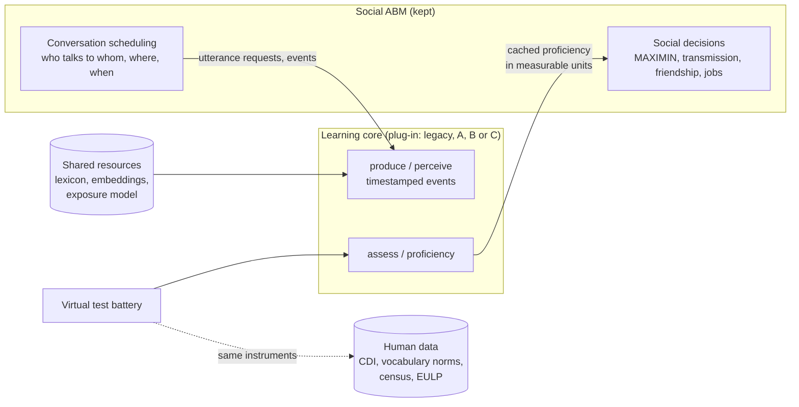

# Rethinking the learning model: shortcomings and three candidate approaches

> **Status (Nov 2026):** a proposal for discussion. No code has changed. This
> document builds on two earlier analyses:
> [`legacy_language_model_analysis.md`](legacy_language_model_analysis.md)
> (its §7 lists the model's weaknesses; they are cited here as **L1–L11**) and
> [`memory_model_analysis.md`](memory_model_analysis.md) (its findings are cited
> as **M1–M13**). Performance figures for the current code were measured on
> this branch ([Appendix B](#appendix-b--measured-performance-of-the-current-model)).
> Resource figures for the new approaches are order-of-magnitude estimates. Their
> assumptions are spelled out in
> [Appendix A](#appendix-a--resource-estimates-assumptions-and-arithmetic), and
> the first build of any approach should replace them with benchmarks.

---

## 0. Summary

**Why this document.** `bilangsim` exists to study when minority languages
survive in bilingual societies. In the model, every social outcome depends on
what each agent knows of each language: which language a conversation uses,
what parents pass on to children, who befriends whom, who gets which job. That
knowledge is produced by the learning model. Policy scenarios can therefore be
no more reliable than the learning model beneath them. Macro models of language
competition, such as Abrams & Strogatz (2003), treat speakers as states and have
no learning at all. The distinctive promise of an agent-based model is to get
the individual level right. The precondition for using `bilangsim` is a
learning core whose individual trajectories are realistic and **testable
against data that exists or can be collected**.

**Verdict on the current learning model: not reliable enough yet.** It has good
ideas worth keeping: per-word memory, production reinforcing more than
listening, and code-switching that emerges from failed retrieval. But its
problems go beyond the update rule that `memory_model_analysis.md` dissects.
They reach the representation and the missing infrastructure:

1. **Words have no meaning, form or context.** Words are abstract frequency
   slots whose meaning shifts with age. The two languages are mirror images
   with random "similarity". Every setting (home, school, work) draws from the
   same vocabulary distribution, so domain-specific bilingualism cannot emerge
   (S1–S4).
2. **Input and time are ungrounded.** Input volumes are in compressed units
   with no link to measured words per day. Memory depends on how the code
   bundles events into steps and calls (S5–S6).
3. **The memory dynamics contradict robust findings** on spacing, the shape of
   forgetting, age effects and receptive vs productive knowledge (S7–S11).
4. **Outputs are unmeasurable.** The knowledge measure `pct` has no empirical
   counterpart. Nothing the model says about an individual can be checked
   against a census, a vocabulary test or a child-development inventory (S12).
5. **There is no validation or calibration.** About 30 constants are set by
   hand, and there is no test harness, no data pipeline and no sensitivity
   analysis (S13–S14).
6. **It does not scale.** Measured cost is about 0.2 s per agent per simulated
   year, so one 100-year run with 10,000 agents would take about 60 hours.
   That puts the hundreds of runs that calibration needs out of reach (S15).

**Three approaches.** All three keep the social ABM (MAXIMIN, families, schools,
jobs, networks) and replace only the learning core, behind a common interface.
They share a set of foundations:

- a real Catalan–Spanish lexicon;
- a data-grounded exposure model;
- a battery of virtual tests that agents take exactly as humans do;
- a calibration pipeline.

| | **A. Grounded lexical memory** | **B. Developmental connectionist lexicon** | **C. Predictive neural agents** |
|---|---|---|---|
| An agent's knowledge is… | memory traces on real lemmas, with concepts shared across languages | self-organising maps of meaning and sound, joined by learned associations | a small transformer language model |
| Learning rule | ACT-R activation with spacing-sensitive decay (Pavlik & Anderson) | Kohonen map learning and Hebbian links, with plasticity declining with age (DevLex / BLINCS line) | next-token prediction error, with replay to consolidate |
| Role of embeddings | give meaning, semantic fields and context (from stage A1) | are the semantic input to the maps | are learned internally; context comes from self-attention |
| Emerges instead of being written in | code-switching, cognate advantages, receptive/productive gaps | all of A's, plus age-of-acquisition effects, entrenchment, child-vs-adult attrition | all of B's, plus grammar, borrowing, contact-induced change |
| Minimal first build | **A0**: single-agent learner and test harness on a laptop | **B0**: 1,000-concept lexicon; laptop or one small GPU | **C0**: ~60 single-agent learners; one 24–32 GB GPU |
| 10,000 agents × 100 years | 16–32-core workstation, 32–64 GB RAM, ~2–4 h per run | 1–4 data-centre GPUs, ~1–15 GPU-hours per run | GPU cluster, ~850 GPU-hours per run (cheaper routes in §6.7) |
| Testability | high | medium–high | medium |

**Recommendation.** First build the shared foundations and **A0**. A0 is small,
but it rests on established theories of memory and of the bilingual lexicon. It
can be validated on a laptop against more than a dozen published findings, and
it gives the social model proficiency in measurable units. B and C are research
tracks that plug into the same interface and face the same tests. Adopt one of
them only if it beats A on those tests, or explains something A cannot.

---

## 1. Requirements: what the learning model must deliver

The learning model is the bridge between experience and knowledge. Experience
means who an agent talks to, in which language, how often and about what.
Knowledge is what then drives the agent's social decisions. The new model must
meet these requirements:

| # | Requirement | How it is tested |
|---|---|---|
| **R1** | Map exposure histories to competence **in units that real data uses**: known-word counts, child-inventory checklists, test scores, comprehension coverage, census self-report levels. | Agents take the same instruments as humans (§3.4). |
| **R2** | Reproduce robust findings about individual learning and forgetting: spacing, power-law forgetting with a long tail, frequency effects, age effects on acquisition and attrition, receptive knowledge exceeding productive. | Single-agent scenarios with acceptance bands (§3.5). |
| **R3** | Represent interaction between the two languages: competition between translation equivalents, cognate facilitation, code-switching, shifts in dominance. | Cognate and dominance findings from Catalan–Spanish bilinguals (§3.5). |
| **R4** | Represent meaning and context, so that the vocabulary used at home, at school and at work can differ. | Domain-specific vocabulary profiles (stage A1 and later). |
| **R5** | Give the same answer for the same experience, whatever the bookkeeping: how events are chunked, the step length, call order, initial conditions vs live dynamics. | Invariance tests (V10). |
| **R6** | Be identifiable: few enough free parameters, each estimable from data with uncertainty. | Calibration by simulation-based inference (§3.6). |
| **R7** | Scale to ≥ 10,000 agents over 100 years, and to the hundreds or thousands of runs that calibration and sensitivity analysis need. | Benchmarks (Appendix A). |
| **R8** | Sit behind a small, stable interface, so learners can be swapped and compared, with the legacy learner kept as a baseline. | Interface contract (§3.1). |

---

## 2. Assessment of the current learning model

### 2.1 What to keep

- **Knowledge per word**, not a single proficiency number.
- **Speaking reinforces more than listening.** This is the production effect
  (MacLeod et al., 2010). The 10:1 ratio, however, should be estimated, not
  asserted.
- **Code-switching that emerges from failed retrieval**, with no separate
  switching module.
- **Frequency-structured input.** The three-stage Zipf–Mandelbrot distribution
  fitted to the British National Corpus is a sound basis for sampling.
- **Encoding needs repeated exposure.** The idea behind `mem_eff` is right
  (Webb, 2007; Uchihara et al., 2019). The mechanism should come from inferring
  meaning, not from a random threshold.
- **The social layer**: MAXIMIN, language choice that sticks within a
  relationship, and families, schools and jobs. It is outside the scope of this
  document and is kept as is.

### 2.2 Catalogue of shortcomings

Severity is judged by the effect on the research question: how fast shift
happens, intergenerational transmission, and the effect of policies.

| ID | Shortcoming | Sources | Consequence | Violates |
|---|---|---|---|---|
| **Representation** | | | | |
| S1 | Words are 500 abstract compressed slots. A slot's meaning (the band of real words it stands for) changes with the agent's age, but its memory does not. | M8, L11 | Vocabulary growth comes for free. The high-frequency head is coarse. No vocabulary test can be simulated. | R1, R2 |
| S2 | **Vocabulary ignores setting.** Word intents are drawn from the age-indexed distribution only (`agent.py:846`, `:894–896`). Setting, topic and relationship never enter. | new (§2.3a) | Home, school and work talk use identical vocabularies. Domain-specific bilingualism and shift that proceeds domain by domain cannot emerge. | R4 |
| S3 | **The two languages are abstract mirror images.** Both share one frequency distribution and one concept-to-slot map. Their "similarity" is random binomial edit distances. | L3, M10, M11, new (§2.3b) | The closeness of Catalan and Spanish (many cognates) cannot be represented, and neither can the difference from an unrelated pair. | R3 |
| S4 | The code-switch stores `L12`/`L21` are artefacts. The cascade reinforces the wrong trace and inflates `L1`. The `L12` `pct` is never updated. | M4, L1, L2 | Dominance is mis-measured. Code-switching feeds a store that counts as the other language. | R3 |
| **Input and time** | | | | |
| S5 | **Exposure volumes are ungrounded.** A conversation carries 1, 3, 10 or 100 compressed tokens (`num_words_conv`), times `num_days`. The IC recipe uses ~4,000 tokens per step, the live model ~8,000. Infants hear nothing in their first year. | M13, new (§2.3c) | There is no link to measured daily input, so the learning rates cannot be calibrated. | R1, R6 |
| S6 | Memory depends on bookkeeping: bundling events into one call, an off-by-one in `t`, call order. | M2, M12 | The same experience gives `S` = 9.4, 24.9 or 142.5 depending on how calls are split. | R5 |
| **Memory dynamics** | | | | |
| S7 | The SuperMemo formula is applied additively and rescaled. Cramming beats spacing, and forgetting a word is rewarded. | M1, M2, M3 | The pattern of use (regular vs bursty) is mis-weighted. Dormant languages recover too easily. | R2 |
| S8 | Forgetting is a single exponential, with no permastore and no age profile. | M5, M6, L4 | Shift through disuse is too fast for adults and too slow in token terms for children. | R2 |
| S9 | Receptive and productive knowledge share one trace. | M9 | Receptive-only (heritage) bilinguals are poorly represented. | R1, R2 |
| S10 | The two languages do not interact in memory: no competition, and no cognate effect beyond random recognition. | M10 | There is no "my L1 is getting rusty" phase driven by competition. | R3 |
| S11 | Encoding of new words is inconsistent and depends on order. | M11 | Learning speed depends on arbitrary details. | R2, R5 |
| **Measurement** | | | | |
| S12 | `pct` (share of slots with `R > 0.9`) has no empirical counterpart. The social thresholds 0.025, 0.1, 0.2 and 0.3 have no empirical meaning. | M7 | Social decisions react to rare-word forgetting. Outputs cannot be compared with any census or test. | R1 |
| **Testability** | | | | |
| S13 | **There is no validation or calibration machinery.** About 30 constants are set by hand, there are no single-agent scenarios, no datasets are wired in, and conclusions rest on single-seed runs. | L8, new (§2.3d) | Nobody can tell whether a result reflects the mechanism or the constants. | R6 |
| S14 | Initial conditions and live dynamics follow different memory rules. | M13 | Start-up transients and drift caused by cohort replacement. | R5 |
| S15 | **It does not scale.** Cost is ~0.2 s per agent per simulated year, and about two thirds of it is learning updates (Appendix B). | new (§2.3e) | 10,000 agents ≈ 60 h per 100-year run, so calibration ensembles are infeasible. | R7 |
| S16 | Individual differences come only from `mem_eff`. Measurable traits are missing, such as a person's rate of forgetting, which is stable within a type of material (Sense et al., 2016). | new | Individual differences are noise rather than calibrated traits. | R2, R6 |
| S17 | Literacy is absent in practice: only the spoken-only path is used. Censuses, however, measure reading and writing. | new | Two of the four census knowledge levels cannot be modelled. | R1 |

### 2.3 Five problems the earlier analyses did not cover

**(a) Vocabulary ignores setting (S2).** `pick_vocab` samples word intents
with `randZipf(cdf_data['s'][age], …)`. The only conditioning is the speaker's
age, or the age of the youngest listener. A teacher in class, parents at
dinner and colleagues at work all draw from the same distribution. The legacy
analysis lists "a bilingual who knows kitchen vocabulary in L1 only and work
vocabulary in L2 only" as a strength of per-word memory. The representation
could indeed hold such a profile, but the dynamics can never produce it. This
matters because, in the sociolinguistics of language shift, languages are lost
and kept domain by domain: home, school, work, administration, media (Fishman,
1991). A model in which domains do not differ lexically cannot represent the
classic shift pattern, where the minority language retreats to the home.

**(b) The languages are mirror images (S3).** `L1` and `L2` share one frequency
distribution and one mapping from concepts to slots. Their similarity is random
numbers. Real language pairs differ in typological distance. Catalan and
Spanish are closely related, and their many cognates ease comprehension and
learning and shape lexical access. Catalan–Spanish bilinguals name pictures
faster when the names are cognates, especially in their non-dominant language
(Costa, Caramazza & Sebastián-Gallés, 2000). Because the model cannot represent
the distance between two languages, it cannot say whether a conclusion drawn
for Catalan–Spanish would hold for Basque–Spanish.

**(c) Quantities are not in measurable units (S5, S12).** On the input side, one
compressed token stands for a band of about 20 real words, and conversations
carry 1–100 such tokens. Nothing maps a simulated conversation onto the number
of words a person hears or says per day. Those numbers have been measured: in
Mehl et al. (2007), adults spoke about 16,000 words a day on average, with very
wide individual variation, and the LENA daylong recordings of Gilkerson et al.
(2017) give norms for the adult words children hear. On the output side, `pct`
corresponds to no test. **Neither end of the learning model can be checked
against data.**

**(d) No validation or calibration machinery (S13).** The constants include the
SM-2 `a, b, c, d`, the speak/listen factors 1 and 0.1, `mem_eff ∈ [3, 6]`, the
thresholds 0.025, 0.1, 0.2, 0.3 and 0.9, `max_edit_dist`, `mean_word_distance`,
the bilingual IC keys, the conversation sizes, `F_S`, `words_day_factor` and the
vocabulary-ceiling curve. None was estimated from data, and none has been
through a sensitivity analysis. With today's speed, brute-force calibration is
not feasible either (S15).

**(e) It does not scale (S15).** The cost is linear in population at about
0.21 s per agent per simulated year:

| Agents | Simulated year |
|---|---|
| 400 | 80 s |
| 1,000 | 214 s |
| 2,000 | 445 s |

So 10,000 agents would need about 2,200 s per simulated year, or **about
60 hours per 100-year run** on one core. Profiling shows that about two thirds
of the time goes to learning updates. These run as about 140 small Python calls
per agent per step. On top of that, every step sweeps all four stores of every
agent to apply decay, whether a word was used or not. The details are in
[Appendix B](#appendix-b--measured-performance-of-the-current-model).

### 2.4 Why this matters for the research question

The chain from experience to macro outcome is:

```
exposure ─► memory update ─► pct ─► thresholds ─► social decisions ─► macro outcomes
(S5, S6)    (S7–S11)        (S12)    (S12)        (MAXIMIN, transmission,   (shift speed,
                                                   friendship, jobs)         bilingual share)
```

Distortions at each link reach the outcomes the project studies:

- **Shift speed is likely over-estimated.** Adult forgetting is too fast and is
  measured on rare words (M5 + M7).
- **Policy comparisons are tilted.** Bursty settings such as school and work
  are over-weighted against regular community contact (M2).
- **Domain-by-domain shift is impossible** (S2).
- **There is no way to validate any of it.** Outputs are not in units that
  censuses or tests use (S12).

### 2.5 Fix or replace?

`memory_model_analysis.md` proposes fixes inside the slot representation
(Options A–C). They would repair S6–S8, and they are worth applying to the
legacy learner if it is kept as a baseline. But S1–S5, S12 and S13 concern
*what the model represents* and *how it connects to data*. No update rule can
fix them. The conclusion is a **new learning core behind an interface**, with
the legacy learner wrapped unchanged as a reference implementation. That keeps
legacy behaviour reproducible, in line with the project's practice so far.

---

## 3. Shared foundations

These pieces are built once and serve all three approaches. They are also what
makes the approaches comparable: same interface, same inputs, same tests, same
data.

### 3.1 Architecture: the learning core as a plug-in



**Interface contract** (sketch):

| Call | Purpose | Notes |
|---|---|---|
| `add_agent(id, birth_day, traits)`, `remove_agent(id)` | lifecycle | `traits` holds individual parameters, e.g. rate of forgetting |
| `produce(speaker, lang, setting, audience, size, day)` → `Utterance` | what the speaker actually says | A, B: a list of (concept, lemma, language, count); C: token sequences |
| `perceive(listeners, utterance, day)` → per listener: coverage, understood?, learning events | comprehension and learning | learning is applied at the event's timestamp |
| `advance(day)` | moves the clock | no per-step sweeps: decay is evaluated lazily from timestamps |
| `assess(ids, battery, day)` → scores | runs virtual tests | same instruments as humans (§3.4) |
| `proficiency(id)` → per language: understands, speaks, coverage, productive rate | what the social layer reads | refreshed periodically (e.g. monthly) from `assess` |
| `snapshot()`, `restore()` | persistence | |

**Design rules.**

1. **Time is measured in days, and every event carries a timestamp.** A course
   attended on 7 days of a 10-day step becomes 7 events on 7 days. Memory is
   computed from timestamps, so results do not depend on the ABM's 10-day step,
   on how calls are split, or on call order. This fixes M2 and M12 by
   construction and makes V10 testable.
2. **Coupling runs at two speeds.** Social decisions read *cached* proficiency,
   refreshed periodically from `assess`. Learning events are processed in
   batches at the end of each step. This allows vectorised CPU kernels (A) and
   GPU batching (B, C). Within a step, the semantics of the social logic barely
   change: decisions that today read `pct` read the cached proficiency instead.
3. **Measurable proficiency replaces `pct`.** The social thresholds are
   redefined in measurable units:
   - "understands L" could mean an expected coverage of everyday speech of at
     least 95%; at 95% coverage listeners still understand reasonably well
     (van Zeeland & Schmitt, 2013).
   - "speaks L" could mean productive success on core concepts above a
     calibrated value.

   The exact cut-offs become calibration targets against census data. Each
   legacy threshold maps onto a measurable replacement:

   | Legacy threshold | Role in the social layer | Measurable replacement |
   |---|---|---|
   | `lang_passive_thresh = 0.025` | "understands" (MAXIMIN's test for a real monolingual) | expected coverage of everyday speech ≥ ~95% |
   | `lang_act_thresh = 0.1` | "can speak" | productive success on a core-concept set ≥ a calibrated value |
   | `switch_threshold = 0.2` | bilingual vs monolingual label | "speaks" both languages by the rule above |
   | friendship `\|Δpct\| ≤ 0.3` | linguistic similarity of friends | difference in coverage or productive scores, recalibrated |

4. **The legacy learner becomes a plug-in.** An adapter routes the social
   layer's calls through the interface while the legacy learning code stays
   unchanged. The result is the `legacy` plug-in. Every comparison runs the
   same social model with a different learner.

### 3.2 Lexical resources (Catalan–Spanish reference case)

Catalan–Spanish is the reference case because the code already models a
Spanish/Catalan society and the data available for it is unusually rich. The
learning core itself stays language-agnostic. A **concept** is a set of
translation-equivalent lemmas, one per language at first. Concepts come from a
bilingual dictionary, filtered to lemmas present in both frequency lists. Early
stages simplify polysemy to the dominant sense.

| Resource | Candidate source | Used for | Status |
|---|---|---|---|
| Spoken-like word frequencies | **SUBTLEX-CAT** (Boada et al., 2020): ~278 M words of Catalan TV subtitles, with frequency and contextual diversity. **SUBTLEX-ESP** (Cuetos et al., 2011). | concept and lemma frequencies in adult registers | available |
| Child-directed speech | **CHILDES** Catalan and Spanish corpora, including Serra/Solé (monolingual Catalan and bilingual Catalan–Spanish children, recorded monthly from about 1 to 4 years) | child-directed register; infant input | available; small |
| Lemmatisation and part of speech | spaCy or Stanza pipelines for Catalan and Spanish | mapping corpora to lemmas | available |
| Translation equivalents (concepts) | **Apertium spa–cat** bilingual dictionary (`apertium-spa-cat.spa-cat.dix`), cross-checked with nearest neighbours in aligned embeddings | concept nodes linking the two languages' lemmas | available; needs cleaning |
| Cognate strength | normalised orthographic distance (A0) and phonological distance (later) between translation equivalents; IPA from espeak-ng | cognate effects in recognition, transfer, competition | computable |
| Semantic embeddings | **fastText aligned vectors** for `ca` and `es` (Joulin et al., 2018; Wikipedia-based; CC BY-SA 3.0) | meaning, semantic fields, context (A1); semantic input (B) | available |
| Vocabulary-size and prevalence norms | **Catalan**: prevalence norms for 40,777 words from more than 200,000 native speakers; age is the main participant factor (Guasch et al., 2023). **Spanish**: **SPALEX** (Aguasvivas et al., 2018), ~170,000 native speakers, 45,389 words, with response times. | adult vocabulary size by age; item difficulty; response-time frequency effects | available |
| Age-of-acquisition norms | **Spanish**: 7,039 words (Alonso, Fernández & Díez, 2015). **Catalan**: none found. | AoA targets | partial (Catalan gap) |
| Text corpora for neural agents (C) | subtitle and conversational corpora (OPUS OpenSubtitles); Catalan corpora from BSC / Projecte AINA | training exposure for C | available; licences to check |

### 3.3 Exposure model

Learning depends on how much input there is and what it consists of. The
exposure model is therefore a foundation of its own, calibrated separately from
memory parameters. It turns the ABM's conversations into **sizes in real words**
and **registers**: child-directed, conversational, school, media.

| Quantity | Data source |
|---|---|
| Words spoken per day | Mehl et al. (2007): about 16,000 on average, with very wide individual differences. |
| Words heard per day by young children | LENA daylong recordings (Gilkerson et al., 2017): adult word counts are roughly independent of age after early infancy, and lower in lower-SES families. |
| Time per setting (home, school, work, leisure, media) | time-use surveys (e.g. INE's *Encuesta de Empleo del Tiempo*) |
| Language used per setting, by age and origin | **EULP** (*Enquesta d'usos lingüístics de la població*; Idescat and the Catalan government; editions 2003, 2008, 2013, 2018, 2023): language use with family, friends, at work and in shops; self-reported. |
| School hours per language | curriculum regulations per language policy |
| Media exposure per language | EULP and media-consumption surveys |

The calibration targets are daily volumes per simulated agent that match the
measured distributions, and language shares per setting that match the EULP.

**Exposure model v0, for A0's scripted life histories.** Until the coupled ABM
supplies exposure, single-agent scenarios use scripted histories:

1. **Daily volume by age.** Words heard rise from infancy to adult levels, and
   words spoken start at about 18 months. Adult values are anchored to Mehl et
   al. (2007) and child input to the LENA norms.
2. **Language shares per profile.** The same six exposure levels as today's IC
   buckets (100, 90, 75, 50, 25 and 10%), plus *switch* scenarios in which one
   language stops, for example at age 8 or at age 30 (V4/V5).
3. **Registers by age.** Child-directed input dominates until about 5–6 years;
   conversational input after that.
4. **Weekly rhythm.** Events land on actual days, school or work days vs
   weekends, so that spacing is realistic.

The same scripts drive the wrapped `legacy` learner, so old and new can be
compared on identical experience.

### 3.4 The virtual test battery

Agents take the same instruments humans take, so model outputs and human data
are directly comparable.

| Instrument | Measures | Human data | Ages |
|---|---|---|---|
| **CDI** (MacArthur–Bates Communicative Development Inventories), Words & Gestures and Words & Sentences | words understood and produced, from a checklist | Spanish (European) data in Wordbank (Frank et al., 2017). A Catalan adaptation exists (*Inventaris del desenvolupament d'habilitats comunicatives MacArthur-Bates en català*); data access to be checked. | 8–30 months |
| Receptive and expressive vocabulary, school age | vocabulary scores against exposure | Thordardottir (2011); Hoff et al. (2012) | 2–6 y |
| Vocabulary size / prevalence | number of known lemmas out of ~40,000 | Guasch et al. (2023), Catalan; SPALEX, Spanish | adults, by age |
| Lexical decision (**LexTALE-Esp**) | proficiency score; response times | Izura, Cuetos & Brysbaert (2014). Ferré & Brysbaert (2017) show it separates Catalan- from Spanish-dominant bilinguals, with non-cognate items discriminating best. No Catalan version found. | adults |
| Picture naming with cognate and non-cognate items (e.g. MINT-style; Gollan et al., 2012) | productive access, latency, cognate effect | Costa et al. (2000), Catalan–Spanish bilinguals | adults |
| Coverage of everyday speech | comprehension in coverage units | Hu & Nation (2000); van Zeeland & Schmitt (2013) | all |
| Self-report | the census's four levels (understands, speaks, reads, writes); EULP competence scales | Idescat census; EULP | census: from about 2 y; EULP: 15 y and over |

Self-reports need a model of their own. Self-ratings correlate with test
scores without matching them (Marian, Blumenfeld & Kaushanskaya, 2007,
validated the LEAP-Q this way). The mapping from test score to self-reported
category is therefore a calibrated function, fitted where both kinds of data
exist.

### 3.5 Validation targets

V1–V10 come from `memory_model_analysis.md` §4.6. V11–V18 are new. Following
*pattern-oriented modelling* (Grimm et al., 2005), the learner must reproduce
several patterns at once, at different levels, rather than fit one curve well.

| # | Finding | Source | Level |
|---|---|---|---|
| V1 | Spaced use beats massed use, and the optimal gap grows with the retention interval | Cepeda et al. (2006, 2008) | single agent |
| V2 | Forgetting has a power-law-like long tail | Wixted & Ebbesen (1991); Rubin & Wenzel (1996) | single agent |
| V3 | Well-learned vocabulary reaches a "permastore" plateau | Bahrick (1984) | single agent |
| V4 | Adult L1 attrition is modest, even after decades | Schmid (2011); de Bot et al. (1991) | single agent |
| V5 | L1 loss in childhood can be near-complete | Pallier et al. (2003); Bylund (2009) | single agent |
| V6 | Frequent words are known by more people and recognised faster | SPALEX; Guasch et al. (2023); SUBTLEX validations | single agent |
| V7 | Comprehension needs about 95–98% coverage | Hu & Nation (2000); Laufer & Ravenhorst-Kalovski (2010); van Zeeland & Schmitt (2013) | single agent |
| V8 | Receptive knowledge exceeds productive; the heritage-speaker profile | Polinsky & Kagan (2007) | single agent |
| V9 | Plausible vocabulary growth in childhood and adulthood | Fenson et al. (1994); Wordbank; Brysbaert et al. (2016): ~42,000 lemmas at 20 y; Guasch et al. (2023) | single agent |
| V10 | Invariance to chunking, step length and IC vs live dynamics | — | single agent |
| V11 | Exposure share predicts vocabulary in each language; bilinguals' combined vocabulary is comparable to monolinguals' | Pearson, Fernández & Oller (1993); Hoff et al. (2012); Thordardottir (2011) | single agent |
| V12 | Receptive vocabulary reaches monolingual levels at lower exposure than expressive vocabulary | Thordardottir (2011) | single agent |
| V13 | In childhood, cumulative exposure matters more than age of onset | Thordardottir (2011); Unsworth (2013) | single agent |
| V14 | Cognates are named faster, more so in the non-dominant language | Costa et al. (2000) | single agent |
| V15 | Incidental learning needs repeated encounters; repetition has a medium effect (r = .34) | Webb (2007); Uchihara, Webb & Yanagisawa (2019) | single agent |
| V16 | An individual's rate of forgetting is stable within one type of material | Sense et al. (2016) | trait distribution |
| V17 | Census and EULP knowledge distributions by age, birthplace and years of residence (immigrants' L2 curves) | Idescat census; EULP | population |
| V18 | The ability to learn grammar declines after late adolescence | Hartshorne, Tenenbaum & Pinker (2018) | single agent (C only) |

### 3.6 Calibration and uncertainty

1. **Set acceptance bands before fitting**, so the model is not tuned to taste.
2. **Global sensitivity analysis** (Sobol indices, SALib; Herman & Usher, 2017) on the single-agent
   harness. Fix the parameters that do not matter.
3. **Single-agent calibration** by simulation-based inference: neural posterior
   estimation with the `sbi` package (Tejero-Cantero et al., 2020; Cranmer,
   Brehmer & Louppe, 2020) against V1–V16. The likelihood is intractable, but
   simulating is cheap.
4. **Population calibration.** Draw parameters from the posterior, run ABM
   ensembles and compare with V17. Use Gaussian-process emulators where runs
   are expensive.
5. **Hold out targets.** For example, fit on the child inventories and the
   prevalence norms, and validate on attrition and on Thordardottir's exposure
   curves.
6. **Report ensembles with uncertainty bands**, never single runs.

### 3.7 Initial conditions by spin-up

Initial conditions come **from the same learner**. Each initial agent's life is
simulated from birth to its starting age, with an exposure profile drawn from
its language type, family and schooling. This removes M13 by construction. The
cost differs by approach:

- **A:** seconds per agent.
- **B:** minutes per agent.
- **C:** expensive. Train a few dozen to a few hundred *archetype* histories,
  then clone them and fine-tune each clone on an individual history.

Spun-up states can be cached by exposure profile, age and seed, much like
today's IC table.

### 3.8 Data we can collect ourselves

Some of the most valuable data does not exist yet but can be collected:

1. **An online bilingual vocabulary study.** Participants take LexTALE-style
   tests in Catalan and Spanish and fill in a language-history questionnaire
   (LEAP-Q, Marian et al., 2007, or the Bilingual Language Profile, Birdsong,
   Gertken & Amengual, 2012). The Catalan prevalence study reached more than
   200,000 participants this way. The result pairs *exposure histories* with
   *vocabulary in both languages*, which is the single most informative
   dataset for calibrating any of the three learners. A Catalan LexTALE-like
   test would be a by-product, filling a gap.
2. **Experience sampling of language use.** Smartphone prompts record who the
   person is talking to, where, in which language and for how long. This
   calibrates the exposure model.
3. **Daylong audio recordings in bilingual families**, with automatic language
   identification, to measure children's input per language.
4. **Longitudinal follow-up of people who move** between Catalan-dominant and
   Spanish-dominant areas, or abroad, to measure attrition.
5. **A corpus of spontaneous Catalan–Spanish conversation**, unless a suitable
   one exists, to measure code-switching rates and where switches occur.

Items 2–5 involve personal data: they need GDPR compliance, informed consent
and ethics-committee approval, especially for audio recordings.

### 3.9 Engineering conventions

- **Random numbers.** One `numpy.random.SeedSequence` per run, spawned into
  independent streams per agent and purpose, so adding an agent does not shift
  anyone else's random numbers. B and C use explicit JAX PRNG keys.
- **Formats.** Results and lexicon tables in Parquet. Agent state snapshots in
  Zarr v3, chunked by agent and compressed. A JSON run manifest per run, with
  the git hash, parameters, seeds and data checksums.
- **Model description** follows the ODD protocol (Grimm et al., 2020).
- **Continuous integration.** A fast subset of the harness runs with the test
  suite.

---

## 4. Approach A — Grounded lexical memory

### 4.1 Idea

Each agent has a mental lexicon of **real Catalan and Spanish lemmas** linked to
**shared concepts**. Each (agent, lemma) pair carries a memory trace governed by
the **ACT-R theory of declarative memory**. That theory derives memory's
dependence on frequency, recency and spacing from the statistics of how often,
and when, items occur in the environment; Anderson & Schooler (1991) analysed
child-directed speech among other sources. Pavlik & Anderson (2005, 2008)
extended it to the spacing effect in vocabulary learning. **Lexical access** in
bilinguals follows the shared-concept, competing-lemma architecture of
BIA+/Multilink (Dijkstra & van Heuven, 2002; Dijkstra et al., 2019) and the
Revised Hierarchical Model (Kroll & Stewart, 1994), with inhibitory language
control (Green, 1998). **Embeddings** add meaning and context from stage A1 on.

### 4.2 Representation

| Element | Content |
|---|---|
| Concept `c` | shared across languages; frequency per register; from A1, an embedding vector and a semantic field |
| Lemma `(c, L)` | form, frequency, cognate strength `σ_c ∈ [0, 1]` (form similarity to its translation equivalent), item difficulty offset `β` |
| Trace `(agent, lemma)` | compact activation state (§4.3), about 24 bytes |
| Agent traits | rate-of-forgetting offset (V16), encoding efficiency |

### 4.3 Memory dynamics

The activation of lemma `w` for an agent at time `T` (days) is:

```
m(T)     = β_w + ln( Σ_j  ω_j · (T − t_j)^(−d_j) )     ACT-R base-level activation over encounters j
d_j      = c_dec · exp(m(t_j)) + α                      decay depends on activation at the encounter
                                                        (Pavlik & Anderson, 2005)
P_comp   = 1 / (1 + exp(−(m − τ_comp)/s))               recognition probability
P_prod   = 1 / (1 + exp(−(m − τ_prod)/s)),  τ_prod > τ_comp
                                                        recall probability for production
RT       = F · exp(−m) + t0                             retrieval latency, for lexical-decision
                                                        and naming tests
```

- **`ω_j` is an encoding weight per event type**: produced (`ω_p`), understood
  in context (`ω_c`), unknown word whose meaning was inferred (`ω_i`). It
  replaces `ds_factor`, and the ratios between the weights are estimated, not
  set. (The event weights are an extension of the published model that
  represents the production effect.)
- **Spacing.** An encounter at high activation (massed) gets a larger decay and
  so adds less in the long run. In Pavlik & Anderson's data, the benefit of
  spacing grows with practice and with the retention interval. This fixes M1
  and M2.
- **Long tail.** A sum of power functions gives power-law forgetting and a
  plateau for well-practised words (V2, V3). This fixes M5.
- **Forgetting is never rewarded.** An encounter adds its own trace. The gain
  does not grow with how forgotten the word was. Low-activation encounters do
  decay more slowly, a bounded "desirable difficulty". Old traces still
  contribute, which gives relearning savings. This fixes M3.
- **Two thresholds on one trace** separate receptive from productive knowledge
  (V8). A separate production trace is a later option.
- **Time scale.** Parameters fitted on laboratory sessions (seconds to days)
  must be refitted for decades of natural exposure. Pavlik & Anderson already
  needed an extra scaling of the time between sessions (check its exact form
  in the 2005 paper). A comparable parameter is expected here.
- **Item difficulty `β_w`** is derived from cognate strength and word length,
  and (A1) from concreteness.

**Compact state.** Keeping every encounter is infeasible: a word like *de*
occurs millions of times in a lifetime. The state keeps:

- **Recent encounters, exactly.** The last K encounters (`t_j`, `d_j`), with
  K = 2–3.
- **Older encounters, as a summary.** Their count, first time, last time and
  mean decay, evaluated with Petrov's (2006) approximation.
- **Same-day repeats, capped.** Repeats within one day are processed
  individually, spread over waking hours, up to a cap. The rest go into the
  summary: in this model, beyond a few massed repetitions extra ones add almost
  no long-term strength.

The harness measures the approximation error against an exact, full-history
implementation on single agents. The state takes about 24 bytes per trace.

**If ACT-R fails the harness,** other compact rules can be swapped in behind the
same interface: FSRS (Ye, Su & Cao, 2022; `memory_model_analysis.md` §4.4, C1) or the multiscale
context model (Mozer et al., 2009).

### 4.4 Age

The age effects are **parameterised hypotheses**, unlike in B, where they
emerge. There are three:

- **Encoding gain by age at the encounter**, `g_enc(age)`: higher in childhood.
- **Decay offset by age at the encounter**, `α(age)`: traces encoded in
  childhood decay faster unless reinforced, converging to adult values by
  adolescence.
- **Retrieval in old age:** the threshold `τ` rises after about 70, which
  produces more tip-of-the-tongue failures (Burke et al., 1991).

The first two together make childhood memory fast-in/fast-out and adult memory
slow-in/slow-out, which is what the contrast between V4 and V5 requires. Each
curve has 2–3 parameters, calibrated on V4, V5, V9 and V13.

### 4.5 Comprehension and incidental learning

For a listener hearing an utterance in language `L`:

1. **Recognition.** For each lemma type, recognition succeeds with `P_comp`. If
   the lemma is not recognised but its translation equivalent is known, the
   **cognate route** applies: `P_cog = σ_c^κ · P_comp(equivalent)`. Real form
   similarity replaces the random edit distances. Cognates are also learned
   faster and forgotten more slowly (de Groot & Keijzer, 2000), which `β_w`
   captures.
2. **Coverage** is the token-weighted share of the utterance recognised. The
   utterance counts as understood if coverage ≥ `θ_cov` (calibrated, V7).
3. **Learning.**
   - Recognised lemmas get an encounter with weight `ω_c`.
   - For an unrecognised lemma, the meaning is inferred with probability
     `p_inf = f(coverage, σ_c, context)`, which rises with coverage, cognate
     strength and, from A1, context support. If inferred, the lemma gets an
     encounter with weight `ω_i`. Otherwise no meaning trace is formed.

The need for several encounters before a word is learned emerges from
`p_inf < 1` and the threshold `τ_comp` (V15). The random `mem_eff` is no longer
needed.

### 4.6 Production, competition and code-switching

The speaker draws concept counts from the register's distribution (a Poisson
approximation per concept, so cost scales with the number of word types, not
tokens). For each concept, the target-language lemma `T` and its translation
equivalent `O` compete:

```
P(select T) = exp((m_T + b)/s) / ( exp((m_T + b)/s) + exp(m_O/s) )
```

- **`b` is the language-control bias** toward the intended language. It is
  larger with monolingual listeners (Grosjean's *language mode*, 2001) and with
  better inhibitory control (Green, 1998). Because both lemmas compete,
  heavy recent use of one language makes the other's words harder to select.
  That is the "my L1 is getting rusty" effect seen in immersion (Linck, Kroll &
  Sunderman, 2009), which the legacy model lacks (M10).
- **Retrieval.** The selected lemma must then be retrieved (`P_prod`). If that
  fails, the other lemma is tried. If both fail, the result is a lexical gap:
  omission or circumlocution, which is recorded.
- **Code-switching** is simply selecting `O`. It becomes more likely when the
  target word is weak and when listeners are bilingual. Whether cognates
  *trigger* switches, as the triggering hypothesis proposes (Broersma & de Bot,
  2006), becomes a testable prediction rather than an assumption.
- **Reinforcement goes to the lemma actually used** (fixing M4). Listeners hear
  the lemmas actually used, so code-switched speech teaches the other
  language's words.
- **No `L12`/`L21` stores.** From A1, a learned per-(agent, concept)
  **borrowing habit** is updated from what the agent hears in `L` speech. It
  lets stable loanwords emerge in a community, and their rates can be compared
  with corpora.

### 4.7 Meaning and context with embeddings (stage A1)

- **Semantic fields.** Concept embeddings (aligned fastText) are clustered
  into K fields: family, food, school subjects, work sectors, administration
  and so on.
- **Settings have topics.** Each setting (home, school by grade, work by
  sector, leisure, media) has a distribution over fields, estimated from
  register corpora: CHILDES for home with children, textbooks for school,
  subtitle genres for media. Sampling becomes
  `P(c | setting) ∝ P(c) · Σ_k θ_setting,k · affinity(c, k)`.
- **Context supports inference.** `p_inf` grows with the embedding similarity
  between an unknown concept and the recognised context, a simple form of
  cross-situational learning.
- **Result.** Domain-specific knowledge profiles emerge (S2), and school or
  work language policies act on *those domains'* vocabulary.

### 4.8 What A explains, and what it does not

| Category | Phenomena |
|---|---|
| Reproduced by its mechanisms | spacing; power-law forgetting and permastore; frequency and recency effects; response times; receptive/productive gaps; cognate effects; code-switching through competition; exposure-to-vocabulary curves; domain profiles (A1) |
| Reproduced by fitted age curves (not emergent) | critical-period effects on vocabulary; the age profile of attrition |
| Not represented | grammar, morphology, phonology and accent; contact-induced change beyond lexical borrowing; literacy until A2 |

### 4.9 Minimal first implementation (A0)

**In scope:**

- **Lexicon.** The top 5,000 lemmas per language from SUBTLEX-CAT and
  SUBTLEX-ESP. Concepts from the Apertium spa–cat dictionary, cleaned and
  restricted at first to one-to-one equivalents. Cognate strength from
  normalised orthographic distance.
- **Two registers.** Adult conversational (SUBTLEX) and child-directed
  (CHILDES Catalan and Spanish). Where CHILDES is too small, SUBTLEX reweighted
  by age of acquisition serves as a fallback.
- **Memory.** ACT-R with Pavlik–Anderson decay, compact state, one trace with
  two thresholds, event weights, and the age curves (§4.4).
- **Processing.** Comprehension with coverage and inference; production with
  competition and control bias.
- **Exposure.** Scripted single-agent life histories (0–80 years) from the
  exposure model (§3.3). **No social ABM yet.**
- **Tests.** CDI (Spanish, plus Catalan if the data is accessible), vocabulary
  size, simulated LexTALE-Esp, coverage, cognate/non-cognate naming, and a
  provisional census self-report mapping.
- **Harness.** V1–V15, with an exact full-history ACT-R reference for the
  compact-state error.
- **Interface.** The new learner and the wrapped `legacy` learner run the same
  scripted scenarios.

**Out of scope (later stages):** embeddings, domains and context; borrowing
habits; literacy; traits beyond one rate-of-forgetting offset; coupling to the
social ABM. These are deliberately excluded. Each would add parameters that
cannot be tested until the core passes the harness.

**Acceptance criteria (gate to A1 and to coupling):**

| Target | Criterion |
|---|---|
| V10 | invariance tests exact, within floating-point tolerance |
| V1–V3, V8, V12–V14 | correct qualitative ordering |
| V9 | vocabulary curves inside quantitative bands |
| V11 | exposure share → vocabulary inside quantitative bands |
| V6 | frequency → response-time inside quantitative bands |
| V4–V5 | the age contrast reproduced |

All bands are fixed before fitting (§3.6).

### 4.10 Growth path

| Stage | Adds |
|---|---|
| A1 | embeddings, semantic fields, setting topics, context support, borrowing habits |
| A2 | literacy: reading register; reading/writing levels for the census |
| A3 | coupling to the social ABM at 10,000 agents, with conversation orchestration batched into arrays; population calibration (V17) |
| A4 | full lexicon (~30,000 lemmas per language), phonological cognate similarity, more individual-difference traits |

### 4.11 Technology and resources

- **Language.** Python 3.13 for orchestration, data preparation and analysis.
  The hot loop is in **Numba** kernels (parallel `prange`) over a
  struct-of-arrays layout, with one array per state field indexed
  `[agent, lemma]`. Port the kernel to **Rust** (PyO3 + maturin) only if
  profiling shows Numba is the limit, e.g. at ≥ 50,000 agents or very large
  ensembles.
- **Libraries.** numpy, numba, pyarrow, polars or duckdb, zarr, spaCy or Stanza
  (lemmatisation), rapidfuzz (edit distance), espeak-ng (IPA, from A4), fastText
  vectors and scikit-learn (from A1), `sbi` with PyTorch (calibration), SALib
  (sensitivity).
- **Storage.**
  - Lexicon and resources: Parquet, under 1 GB.
  - Agent state: in memory.
  - Snapshots: Zarr, chunked by agent, zstd-compressed, one per simulated
    decade.
  - Results: Parquet, partitioned by run and year.
  - Run manifests: JSON.

| Tier | Scope | Hardware | Memory | Time | Storage |
|---|---|---|---|---|---|
| **Start** | A0 single-agent harness; calibration with 10⁴–10⁵ single-agent lifetimes; ABM ≤ 2,000 agents | laptop: 8–14 cores, 16 GB. **Your current machine (14 logical cores, 15 GB under WSL) is enough.** | ~1 MB per agent lifetime; 2,000 agents ≈ 0.5 GB | one 80-year lifetime ≈ 10–20 s; 10⁴–10⁵ lifetimes ≈ 3–30 h on 14 cores | < 10 GB |
| **10,000 agents** | A0–A3 coupled, 100 years | workstation: 16–32 cores, 32–64 GB | A0 lexicon: 2.4 GB; A4 lexicon: 14 GB | learning core ≈ 2–4 h per run on 16 cores (≈ 1–2 h on 32) | 10–100 GB per run |
| **Ensembles** | 200–1,000 runs for population calibration and sensitivity | CPU cluster or cloud | as above, per run | 6,000–60,000 core-hours per campaign | summaries ≈ 1 GB per run; full snapshots only for selected runs |

Your current machine could also hold A0 at 10,000 agents (2.4 GB), at roughly
2–4 h per run. That requires the social layer's own cost to come down first,
which A3 needs anyway: today the conversation orchestration outside the
learning updates takes about a third of the runtime (Appendix B).

### 4.12 Risks and mitigations

| Risk | Mitigation |
|---|---|
| The architecture (thresholds, competition, age curves) is designed rather than emergent, so it can show *that* something happens without explaining *why*. | Ground each component in a published model; state clearly which effects are fitted. |
| Parameters from laboratory studies may not transfer to naturalistic exposure. | Calibrate on naturalistic data: CDI, prevalence norms, EULP. |
| Dictionaries give a fuzzy concept inventory: polysemy, equivalents that are not one-to-one. | Start with one-to-one high-frequency pairs; flag the rest. |
| The compact-state approximation introduces error. | Bound it against the exact implementation in the harness. |

---

## 5. Approach B — Developmental connectionist lexicon

### 5.1 Idea

Each agent's lexicon is a **neural network that organises itself from
experience**. It has:

- a **semantic map** and a **phonological map**, both Kohonen
  self-organising maps (Kohonen, 1982);
- **Hebbian associative links** between them, which implement comprehension
  (sound → meaning) and production (meaning → sound).

This is the DevLex line of models:

- **DevLex** (Li, Farkas & MacWhinney, 2004): the two-map architecture.
- **DevLex-II** (Li, Zhao & MacWhinney, 2007): reproduces a vocabulary spurt
  and effects of word frequency and length on age of acquisition.
- **Bilingual extension** (Zhao & Li, 2010): finds strong competition between
  the languages, and plasticity that depends on when L2 learning begins.
- **BLINCS** (Shook & Marian, 2013): a related model of bilingual speech
  comprehension, built from self-organising maps, that accounts for
  cross-language interaction and cognate facilitation.

The attraction is that age-of-acquisition effects, entrenchment, competition
between the languages and the age profile of attrition **emerge from one
learning mechanism** instead of being parameterised one by one.

### 5.2 Representation

- **Semantic input `s_c`.** The concept's vector from the aligned Catalan and
  Spanish embeddings, reduced to about 100 dimensions (PCA). Translation
  equivalents share it, a shared conceptual store as in RHM/BIA+. Stage B2 can
  add language-specific nuances from unaligned monolingual vectors.
- **Phonological input `p_w`.** The word's IPA transcription (espeak-ng),
  encoded with a syllabic template in the style of PatPho (Li & MacWhinney,
  2002). Cognates get similar vectors, so the formal overlap between Catalan
  and Spanish is real, not random.
- **Per agent:** `SOM_sem` and `SOM_phon` (a grid of units, each with a weight
  vector), plus sparse Hebbian links between them (the top *k* per unit). Stage
  B1 adds an output map for phoneme sequences, as DevLex-II has for production.
- **Language membership.** Forms carry a language label, used when decoding and
  for a top-down language-control bias, as the language nodes of BIA+ do.

### 5.3 Learning

For each encounter with word `w` whose meaning `c` is available (inferred from
context as in §4.5, or given by the situation):

```
u* = argmin_u ‖s_c − W_sem[u]‖           v* = argmin_v ‖p_w − W_phon[v]‖     winning units
W_sem[u]  += η(age) · h(u, u*; σ(age)) · (s_c − W_sem[u])                     same for W_phon
L[v, u]   += η_H · a_v · a_u,  then normalise;   L ← (1 − λ)·L per day of disuse
```

- **Plasticity.** The learning rate `η(age)` and neighbourhood width `σ(age)`
  shrink through childhood. The result is entrenchment and a critical period.
- **Daily batches.** Each agent-day's word types are applied with counts that
  enter *sublinearly*, so massed repetitions bring diminishing returns.
- **Caching winners.** For known words, the winning units are recomputed
  periodically (e.g. monthly); for new or unstable words, immediately. This is
  what keeps B affordable.

### 5.4 Comprehension, production and forgetting

- **Comprehension of a heard form.** Activate `SOM_phon` around `v*`,
  propagate through the links to `SOM_sem`, and decode the concept nearest to
  the winning unit. A softmax over the candidate concepts' activations, with
  noise, gives `P_comp(w)`.
- **Production of concept `c` in language `L`.** Activate `SOM_sem`, propagate
  to `SOM_phon`, add the control bias toward `L` forms, and decode the nearest
  form. That form is either the target (success), its translation equivalent
  (code-switch), another word (error) or nothing (gap).
- **Forgetting by interference.** Other inputs pull units away. In a child's
  highly plastic map, a switch of input from L1 to L2 reassigns L1 territory,
  and L1 is nearly lost (V5). The adult's entrenched map keeps L1 (V4). **The
  same mechanism that produces age-of-acquisition effects produces the age
  profile of attrition.**
- **Forgetting by disuse:** slow decay `λ` of the links.
- **Spacing is not native to self-organising maps.** There are two options.
  One is error-driven Hebbian updates (Δ ∝ 1 − current link strength), so
  massed repeats add little. The other is to let A's trace dynamics govern the
  link strengths, a B/A hybrid. V1 decides which works.

### 5.5 What B explains, and what it does not

| Category | Phenomena |
|---|---|
| Emerges from the learning dynamics | age-of-acquisition effects and the vocabulary spurt; entrenchment and age-of-onset effects; child-vs-adult attrition; cognate facilitation and competition between the languages (from phonological overlap and shared meanings); receptive/productive asymmetry (the two link directions) |
| Not native, needs additions | the spacing effect; the long-tail shape of forgetting (must be tested) |
| Not represented | grammar; adult-size vocabularies (scaling self-organising maps from the CDI-sized lexicons of early childhood to tens of thousands of words is untested) |

### 5.6 Minimal first implementation (B0)

- **Lexicon:** 1,000 concepts (the most frequent across child-directed and
  conversational registers) and 2,000 forms (Catalan and Spanish).
- **Maps:** `SOM_sem` 50 × 50 units of 100 dimensions; `SOM_phon` 70 × 70
  units of 80 dimensions; sparse links with *k* = 32.
- **Single-agent harness first**, on the same targets as A where they apply:
  - vocabulary growth at CDI ages under monolingual and bilingual profiles
    (V9, V11);
  - age-of-acquisition predictors against CDI and the Spanish AoA norms;
  - attrition restricted to core vocabulary (V4, V5);
  - cognates (V14) and invariances (V10).
- **Coverage over the modelled lexicon only.** Out-of-lexicon tokens are
  reported separately. This is a limitation of B0. Spoken English needs
  roughly 2,000–3,000 word families for about 95% coverage (Adolphs & Schmitt,
  2003; van Zeeland & Schmitt, 2013), so 1,000 concepts cannot cover adult
  speech. B0 targets early development and the core of everyday vocabulary.
- **Acceptance:** as for A0, plus two emergence checks. Early and late L2 onset
  must lead to different map organisation (Zhao & Li, 2010). The attrition age
  profile must match V4/V5 **without** age-specific memory parameters.

### 5.7 Growth path

| Stage | Adds |
|---|---|
| B1 | output phoneme-sequence map (DevLex-II); production errors |
| B2 | language-specific semantics |
| B3 | larger lexicons (growing or hierarchical maps) |
| B4 | hybrid link dynamics using A's memory rule |

### 5.8 Technology and resources

- **Language.** Python 3.13 with **JAX**: `jit`, and `vmap` over agents. Plain
  `jax.numpy` kernels or Equinox, on GPU. A NumPy CPU reference implementation
  serves the tests.
- **Data preparation.** espeak-ng (IPA), a PatPho-style encoder, fastText
  aligned vectors with PCA (scikit-learn).
- **Storage.** Per-agent weights in Zarr (fp16, chunked by agent batch),
  snapshots once per simulated decade; results in Parquet.
- **Coupling.** The social ABM runs on CPU and the learning core on GPU, with
  events batched per step and proficiency cached (§3.1). For reproducibility,
  enable XLA's deterministic GPU operations.

| Tier | Scope | Hardware | Memory | Time | Storage |
|---|---|---|---|---|---|
| **Start** | B0 single-agent harness (tens of agents); ABM ≤ 1,000 agents | laptop CPU, or any 8–12 GB GPU | ~2.3 MB per agent | one lifetime ≈ minutes on CPU (to benchmark) | < 10 GB |
| **B0 at 10,000 agents** | 100 years | one 32–48 GB GPU (or two of 24 GB), 64 GB host RAM | ~23 GB | ~1–3 GPU-hours per run | ~23 GB per snapshot; ~0.25 TB per run |
| **Full B** (10,000 concepts, 20,000 forms) | 10,000 agents | 2–4 data-centre GPUs of 80 GB, or one GPU plus 512 GB host RAM (offloading) | ~220 GB | ~5–15 GPU-hours per run | ~220 GB per snapshot; ~2 TB per run |
| **Calibration** | single-agent SBI; population through an emulator | GPU cluster or cloud | — | 10³–10⁴ GPU-hours per campaign | — |

### 5.9 Risks and mitigations

| Risk | Mitigation |
|---|---|
| Scaling self-organising maps beyond CDI-sized lexicons is unproven. | Stay with core vocabulary (B0); try growing or hierarchical maps (B3). |
| Many parameters with non-obvious effects: map size, `η` and `σ` schedules, `k`, `λ`. Identifiability is weak and results depend on initialisation. | Sensitivity analysis first; ensembles over seeds. |
| Spacing and the long-term shape of forgetting are not native. | Error-driven links or the B/A hybrid (§5.4). |
| Interpretability is moderate: it is harder to diagnose why an agent lost a word than in A. | Diagnostics on unit territories and link strengths per word. |
| GPU dependence and nondeterminism. | Deterministic XLA flags; the CPU reference implementation. |

---

## 6. Approach C — Predictive neural agents (self-attention)

### 6.1 Idea

Each agent is a **small language model with self-attention**, a decoder-only
transformer. It learns online from what it hears and says by reducing its
**prediction error (surprisal)**. That principle has psycholinguistic support:

- surprisal predicts comprehension difficulty (Hale, 2001; Levy, 2008);
- error-driven learning accounts for syntactic development and priming
  (Chang, Dell & Bock, 2006).

Agents produce **real text**, sampled from their own models, so other agents
learn from it. Conversation thus becomes cultural transmission (*iterated
learning*; Kirby, Cornish & Smith, 2008). This is the only approach in which
grammar, morphology, borrowing and contact-induced change can emerge, for
instance a minority language converging toward the majority one.

### 6.2 Agent model

- **Architecture.** A decoder-only transformer of about 10 M parameters (e.g.
  6 layers, width 320, context of 256 tokens). It uses a **joint Catalan–Spanish
  subword tokenizer** (~16k BPE) whose shared subwords capture cognate overlap
  and shared morphology.
- **Control prefix:** setting, age band of the listener, intended language. The
  link between the language tag and what comes out is learned from experience.
  That learned link *is* the agent's language control.
- **Plasticity.** The learning rate `η(age)` declines after childhood. This can
  be tested against the critical period for grammar: Hartshorne et al. (2018)
  find grammar-learning ability stays high until late adolescence (about 17)
  and then declines (V18).
- **Consolidation by complementary learning systems** (McClelland, McNaughton
  & O'Reilly, 1995; Kumaran, Hassabis & McClelland, 2016):
  - a per-agent **episodic buffer**, a reservoir of past utterances;
  - "nightly" **replay** of the buffer, interleaved with new input;
  - an optional EWC-style penalty (Kirkpatrick et al., 2017) that grows with
    age.

  Buffer size and replay rate set the balance between retention and
  *catastrophic interference* (McCloskey & Cohen, 1989), and they are
  calibrated on V4/V5.

### 6.3 Learning, comprehension and production

- **Learning.** One SGD step on next-token loss per utterance heard (weight
  `ω_c`) and per utterance spoken (`ω_p`, the production effect). Plain SGD,
  with no optimiser state, is closer to single-pass human learning and saves
  memory.
- **Comprehension** is measured by word-level surprisal. A word counts as
  understood if its surprisal in context is below a threshold; utterance
  coverage follows, as do cloze-style measures.
- **Production.** The agent samples from its model given the control prefix.
  Code-switching happens when the model's probability mass for the intended
  language is weak in that context. Grammaticality and interference can be
  measured on the output.
- **Anchoring input.** Besides agents' speech, media and school input come from
  fixed corpora such as TV subtitles and textbooks. This matches reality, since
  media are an exogenous channel and a policy lever. It also prevents
  degenerate drift: models trained recursively on generated data lose the rare
  parts of the distribution (*model collapse*; Shumailov et al., 2024). That
  phenomenon is an interesting analogue of lexical impoverishment in minority
  languages, but it must be told apart from artefacts.

### 6.4 Measurement

The same battery is administered by probing the models:

- **CDI words "known":** a surprisal criterion, following Chang & Bergen's
  (2022) method for ages of acquisition in language models.
- **Lexical decision:** log-probability of a word against a pseudoword
  (LexTALE items).
- **Naming:** cloze or definition prompts that elicit a target concept in a
  given language.
- **Grammar:** minimal pairs. Catalan and Spanish test sets would have to be
  built.
- **Coverage and self-report:** as in A.

### 6.5 What C explains, and what it does not

**Potentially,** everything A and B represent, plus grammar, morphology,
borrowing, convergence and context-dependent code-switching.

**Known caveats:**

- **Language models learn words differently from children.** They depend far
  more on word frequency, and concreteness, word length and lexical class
  affect them differently (Chang & Bergen, 2022). The authors attribute this to
  the missing interaction and sensorimotor experience.
- **Data efficiency.** Children acquire language from fewer than 100 million
  words; large language models typically use three to four orders of magnitude
  more (Warstadt et al., 2023). Learning from a single online pass is harder
  still.
- **Timescales are not calibrated.** Forgetting and spacing are not tuned to
  human memory by default and must be tested (V1–V5).

### 6.6 Minimal first implementation (C0)

**No social ABM.** The steps are:

1. **Build the tokenizer and exposure streams:** child-directed (CHILDES ca/es),
   conversational (subtitles, e.g. OPUS OpenSubtitles), and school and media.
2. **Train about 60 single agents from scratch to age 30:** 6 exposure profiles
   (100% Catalan, 90/10, 75/25, 50/50, 25/75, 100% Spanish) × 10 seeds, using
   online SGD with replay.
3. **Run the tests:**
   - CDI curves (V9);
   - exposure → vocabulary, receptive vs expressive (V11, V12);
   - cognates (V14);
   - attrition: stop one language at 8 vs at 30 (V4/V5);
   - spacing with controlled re-exposure (V1);
   - invariance to micro-batching, within noise (V10).
4. **Run small iterated-learning populations** (10–50 agents), with and without
   media anchoring, to look for drift and collapse.

**Acceptance.** If C0 cannot reproduce V9, V11 and V4/V5 with plausible
plasticity and replay settings, C stays a research topic. If it can, the next
step is mixed fidelity (§6.7).

### 6.7 Scaling to 10,000 agents

1. **Full: every agent is neural.**
   - Cost: about 850 GPU-hours per 100-year run (Appendix A), so about 4–5
     days on one 8×H100 node.
   - At an assumed $2–4 per GPU-hour, that is roughly $1,700–3,400 per run.
   - Calibration is only possible through emulators.
2. **Mixed fidelity.** For example, 1,000 *focal* neural agents in a society of
   9,000 A-agents, all behind the same interface, at about a tenth of the cost.
   The neural agents give detailed observations of language change, and the
   A-agents carry the population dynamics. On top of that, **exposure
   subsampling** cuts the cost about twentyfold: each agent trains on a
   representative 5% of its tokens, upweighted.
3. **Emulator.**
   - Offline, run thousands of single-agent C lifetimes with sampled exposure
     histories: about 120 GPU-hours for 2,000 lifetimes to age 80.
   - Train a statistical emulator that maps an exposure history to a
     test-battery profile.
   - The ABM then uses the emulator for every agent, on CPU.

   This loses text transmission between agents, and so language change, but it
   keeps the cognitive realism of individual trajectories.

### 6.8 Technology and resources

- **Language.** Python 3.13 with **JAX/Flax (NNX)**, using `vmap` over stacks
  of per-agent parameters. PyTorch with `torch.func` is an equivalent
  alternative. Hugging Face `tokenizers`; Optax for plain SGD.
- **Data and storage.**
  - Corpora: Arrow/Parquet shards, streamed.
  - Checkpoints: safetensors or Orbax; per-agent weight stacks in Zarr.
  - Beyond about 1 TB: S3-compatible object storage, e.g. MinIO.
  - On clusters: Slurm for scheduling, MLflow for experiment tracking.
- **Licensing.** The SUBTLEX source corpora may not be redistributable. OPUS
  and Catalan corpus licences must be checked.

| Tier | Scope | Hardware | Memory | Time | Storage |
|---|---|---|---|---|---|
| **Start (C0)** | ~60 single agents to age 30 | one 24–32 GB GPU | ~10 GB | ≈ 9–10 GPU-hours | corpora 10–50 GB; checkpoints a few GB |
| **Small populations** | 10–50 interacting agents, 50 years | the same | — | hours to days | < 100 GB |
| **Mixed fidelity** | 1,000 neural + 9,000 A-agents, 100 years | one node with 8 × 80 GB GPUs | ~25–50 GB of weights plus A state | ~85 GPU-hours per run (≈ 11 h on the node) | ~25 GB per snapshot |
| **Full** | 10,000 neural agents, 100 years | 8 × 80 GB (bf16) or 8 × 141 GB; better multi-node | 240 GB (bf16) or 480 GB (fp32) | ~850 GPU-hours per run | 240 GB per snapshot; ~2.4 TB per run |
| **Emulator** | 2,000 lifetimes plus emulator | one node or cloud | — | ~120 GPU-hours plus emulator training | ~0.5 TB |

### 6.9 Risks and mitigations

| Risk | Mitigation |
|---|---|
| Cost and engineering complexity (batched heterogeneous models, multi-GPU) | Start with C0; use mixed fidelity or the emulator before any full run. |
| Learning biases that are not human-like: frequency-driven, data-inefficient | Measure them against V9, V11 and age-of-acquisition predictors; make them an explicit finding. To improve data efficiency, agents can be trained against a pretrained teacher, a strategy that worked in BabyLM (Warstadt et al., 2023). An open Catalan–Spanish-capable model such as Salamandra (BSC, 2025) could serve, at some cost to developmental purity. |
| Catastrophic interference instead of realistic attrition: replay and plasticity may not satisfy V4 and V5 at once | Calibrate buffer, replay rate and plasticity; stop at C0 if both cannot be met. |
| Model collapse in iterated learning; telling artefacts from real contact effects | Anchoring corpora; compare runs with and without anchoring. |
| Grammar is hard to test in Catalan (few test sets); low interpretability | Build minimal-pair sets; probe on targeted constructions. |
| GPU reproducibility | Fixed seeds, deterministic kernels, archived checkpoints. |

---

## 7. Comparison and recommendation

### 7.1 Comparison

| Criterion | A. Grounded lexical memory | B. Developmental connectionist | C. Predictive neural agents |
|---|---|---|---|
| Scientific basis | ACT-R declarative memory and Pavlik–Anderson spacing; BIA+/Multilink, RHM, inhibitory control | DevLex, DevLex-II, bilingual DevLex, BLINCS | surprisal, error-driven learning, complementary learning systems |
| Spacing (V1) | built in | needs an added mechanism | to be tested |
| Forgetting shape, permastore (V2–V3) | built in | to be tested | to be tested |
| Child vs adult attrition (V4–V5) | fitted age curves | **emerges** (entrenchment) | plasticity plus replay; to be tested |
| Vocabulary growth, age of acquisition (V9) | from exposure and frequency | **emerges** | emerges, but too frequency-driven |
| Exposure → vocabulary; receptive vs expressive (V11–V12) | yes | yes | yes |
| Cognates (V14) | real form similarity | emerges from phonology | emerges from shared subwords |
| Code-switching | competition with language control | competition | contextual and structural |
| Domains and context | A1 (embeddings) | partly (semantic map plus setting cues) | native |
| Grammar, borrowing, contact change | lexical borrowing only (A1) | no | **yes** |
| Free parameters | ~15–20, interpretable | ~20–30, partly opaque | architecture plus ~10 learning settings; opaque |
| Calibration | full SBI feasible on CPU | single-agent SBI on GPU; population through an emulator | emulator only |
| Interpretability | high | medium | low |
| Minimal-build hardware | laptop (your current machine) | laptop or small GPU | one 24–32 GB GPU |
| 10,000 agents × 100 years | ~2–4 h on 16–32 cores | ~1–15 GPU-hours | ~850 GPU-hours (~85 with mixed fidelity; emulator route) |
| Storage per run (decadal snapshots) | 10–100 GB | 0.25–2 TB | 0.25–2.4 TB |
| Main risk | designed structure, less emergence | scaling; spacing | cost; non-human learning; collapse |

### 7.2 Recommended path

1. **Foundations.**
   - Interface, with the `legacy` plug-in.
   - Lexicon at A0 scope.
   - Exposure model v0 and test battery v0.
   - Harness with V1–V16, and the calibration tooling.
2. **A0 on single agents.** Calibrate until the acceptance criteria (§4.9) are
   met.
3. **Couple A0 to the social ABM.**
   - Batch the conversation orchestration and benchmark 10,000 agents.
   - Compare `legacy` and A0 on the same scenarios, at both the individual and
     the macro level.
4. **A1 and population calibration.** Add embeddings, domains and borrowing,
   then calibrate the population (V17).
5. **Research tracks, once step 2 is done:** B0 and C0 as single-agent
   bake-offs on the same harness. Promote a track to population scale only if
   one of these holds:
   - it beats A on held-out targets;
   - it explains a target that A only fits (e.g. V5 without fitted age curves);
   - it adds a phenomenon A lacks (grammar, contact change).
6. **Start data collection early** (§3.8), because it has the longest lead
   time. The online vocabulary and language-history study has the highest
   value.

### 7.3 Decision points

| ID | When | Question | If no |
|---|---|---|---|
| D1 | after the A0 harness | Does the ACT-R rule pass V1–V3 and V10? | Swap the memory rule (FSRS or the multiscale context model) behind the interface. |
| D2 | after coupling | Does the population reproduce census knowledge by age within bands (V17)? | Check the exposure model before the learner. |
| D3 | after the B0/C0 bake-offs | Does either track meet the promotion criteria (§7.2, step 5)? | Keep it as a research line; A stays the production learner. |

---

## 8. Open questions for you

1. **Language pair.** Is Catalan–Spanish confirmed as the reference case?
   Should a distant pair, such as Basque–Spanish, be added later to test
   whether conclusions generalise?
2. **Literacy.** Should reading and writing enter early (the census asks about
   them), or does spoken language come first?
3. **Data collection.** Do you want to run the online vocabulary study (§3.8)?
   It needs ethics approval and has the longest lead time.
4. **Social layer.** Should the conversation orchestration be refactored for
   10,000 agents now, or once A0 passes its harness?

---

## Appendix A — Resource estimates: assumptions and arithmetic

All numbers are order-of-magnitude estimates. Each first build must replace them
with benchmarks.

**Common assumptions.**

| Symbol | Value | Basis |
|---|---|---|
| Agents alive | 10,000 | requirement |
| Simulated span | 100 years = 36,500 days → 3.65 × 10⁸ agent-days | requirement |
| Language processed per agent-day (heard + spoken, all sources) | 25,000 tokens on average | ~16,000 words spoken per day (Mehl et al., 2007), similar amounts heard, plus media; children less. To be calibrated. |
| Spoken tokens per agent-day | 10,000 on average | as above, averaged over all ages |
| Distinct lemma types per agent-day | ~3,000 | Heaps-law estimate for ~25,000 tokens of conversational speech |
| Effective GPU throughput | data-centre GPU (H100 class) ≈ 2.5 × 10¹⁴ FLOP/s (≈ 25% of dense BF16 peak); consumer GPU (24–32 GB) ≈ 3 × 10¹³ FLOP/s | typical utilisation for small models |
| Cloud price | $2–4 per data-centre GPU-hour | assumption |

**A.**

- **Memory.**
  - Trace state ≈ 24 B.
  - A0 lexicon (10,000 lemmas): 240 kB per agent, 2.4 GB for 10,000 agents.
  - A4 lexicon (60,000 lemmas): 1.44 MB per agent, 14.4 GB.
- **Updates per run:** 10⁴ agents × 36,500 days × 3,000 = 1.1 × 10¹².
- **Cost per update:** about 100–200 ns (a few transcendental functions plus
  random memory access).
  - Per run: 1.1–2.2 × 10⁵ core-seconds = 30–60 core-hours, i.e. 2–4 h on 16
    cores.
  - Per 80-year single-agent lifetime: 2.9 × 10⁴ days × 3,000 = 8.8 × 10⁷
    updates ≈ 10–20 s.
- **Ensembles:** 200–1,000 runs × 30–60 core-hours = 6,000–60,000 core-hours.

**B.**

- **B0 memory.**
  - Weights: 2,500 × 100 + 4,900 × 80 = 6.4 × 10⁵, or 1.3 MB in fp16.
  - Links: (2,500 + 4,900) × 32 ≈ 2.4 × 10⁵ entries × 4 B ≈ 0.95 MB.
  - Total ≈ 2.3 MB per agent, 23 GB for 10,000 agents.
- **B0 compute.**
  - Daily updates: ~1,000 in-lexicon types × ~2 × 10⁴ FLOP × 3.65 × 10⁸
    agent-days ≈ 7 × 10¹⁵ FLOP. These are irregular operations at an effective
    1–10 TFLOP/s, so 0.2–2 h.
  - Monthly winner refresh: ~2 × 10⁹ FLOP per agent-month × 1.2 × 10⁷
    agent-months ≈ 2.5 × 10¹⁶ FLOP, i.e. minutes.
  - Total ≈ 1–3 GPU-hours.
- **Full B memory.**
  - Weights: 160² × 100 + 220² × 80 = 6.4 × 10⁶, or 12.9 MB in fp16.
  - Links: 7.4 × 10⁴ units × 32 × 4 B ≈ 9.5 MB.
  - Total ≈ 22 MB per agent, ≈ 220 GB.
- **Full B compute.**
  - Winner refresh: ~2 × 10¹¹ FLOP per agent-month × 1.2 × 10⁷ ≈ 2.5 × 10¹⁸
    FLOP ≈ 3 h.
  - Daily updates: ≈ 3 × 10¹⁶ FLOP at 1–10 TFLOP/s ≈ 1–9 h.
  - Total ≈ 5–15 GPU-hours.

**C** (N ≈ 1.2 × 10⁷ parameters).

- **Training:** 6 · N · 25,000 tokens · 3.65 × 10⁸ agent-days ≈ 6.6 × 10²⁰
  FLOP.
- **Generation:** 2 · N · 10,000 tokens · 3.65 × 10⁸ ≈ 0.9 × 10²⁰ FLOP.
- **Total** ≈ 7.4 × 10²⁰ FLOP; at 2.5 × 10¹⁴ FLOP/s that is ≈ 830 GPU-hours.
- **Memory.**
  - Weights: 10⁴ × 1.2 × 10⁷ = 1.2 × 10¹¹ parameters, i.e. 240 GB in bf16 or
    480 GB in fp32. Plain SGD keeps no optimiser state.
  - Episodic buffers: ~2 MB per agent, ≈ 20 GB.
- **Cheaper routes.**
  - Mixed fidelity, 1,000 neural agents: ≈ 1/10 of the full cost, ≈ 85
    GPU-hours.
  - Exposure subsampling at 1/20: ≈ 40 GPU-hours.
- **C0:** 60 agents × 6 · N · 20,000 tokens · 10,950 days ≈ 9.5 × 10¹⁷ FLOP;
  at 3 × 10¹³ FLOP/s that is ≈ 9 h.
- **Emulator training set:** 2,000 lifetimes × 6 · N · 25,000 · 29,200 ≈
  1.05 × 10²⁰ FLOP ≈ 120 GPU-hours.

---

## Appendix B — Measured performance of the current model

**Set-up.** Branch `feature/explore_new_modeling`, `PYTHONHASHSEED=0`.

**Machine.** 14 logical cores and 15 GB RAM visible to WSL2. The model runs as
a single Python process.

**Method.** Construct `BiLangModel(N, num_clusters=k)`, then time
`schedule.step()` (no data collection) for the first 8–12 steps.

| Agents | Clusters | Steps timed | Mean s/step | s per simulated year | s per agent per simulated year | Peak RSS |
|---|---|---|---|---|---|---|
| 400 | 2 | 12 | 2.22 | 80 | 0.20 | 0.77 GB |
| 1,000 | 4 | 12 | 5.95 | 214 | 0.21 | 0.98 GB |
| 2,000 | 6 | 8 | 12.36 | 445 | 0.22 | 1.34 GB |

**Extrapolation.** Cost is linear in population. At 10,000 agents that gives
≈ 2,200 s per simulated year, or ≈ 61 h per 100-year run, with population held
about constant and no data collection. `memory_model_analysis.md` reported
about 100 s per simulated year at 400 agents with instrumentation, which is
consistent.

**Profile.** 1,000 agents, 6 steps, measured with `cProfile`. Percentages are
cumulative and overlap.

| Function | Share of runtime | Calls |
|---|---|---|
| `run_conversation` | 91% | 110k |
| `update_lang_arrays` | 64% | 841k (≈ 140 per agent per step) |
| `update_words_memory` | 34% | 850k |
| `pick_vocab` | 26% | 276k |
| `update_memory_retention` | 15% | 874k |
| `get_conv_params` (MAXIMIN) | 8% | 110k |

Learning updates dominate. They run as hundreds of thousands of small Python
calls per step, plus decay sweeps over every store of every agent. The rest of
the conversation machinery takes most of the remaining time.

---

## Appendix C — References

**Memory, learning and forgetting**

- Anderson, J. R., & Schooler, L. J. (1991). Reflections of the environment in memory. *Psychological Science*, 2(6), 396–408.
- Bahrick, H. P. (1984). Semantic memory content in permastore. *Journal of Experimental Psychology: General*, 113(1), 1–29.
- Burke, D. M., MacKay, D. G., Worthley, J. S., & Wade, E. (1991). On the tip of the tongue. *Journal of Memory and Language*, 30, 542–579.
- Cepeda, N. J., et al. (2006). Distributed practice in verbal recall tasks. *Psychological Bulletin*, 132(3). — Cepeda, N. J., et al. (2008). Spacing effects in learning. *Psychological Science*, 19(11).
- MacLeod, C. M., et al. (2010). The production effect: delineation of a phenomenon. *Journal of Experimental Psychology: Learning, Memory, and Cognition*, 36(3).
- Mozer, M. C., Pashler, H., Cepeda, N., Lindsey, R., & Vul, E. (2009). Predicting the optimal spacing of study: a multiscale context model of memory. *NIPS 22*.
- Pavlik, P. I., & Anderson, J. R. (2005). Practice and forgetting effects on vocabulary memory: an activation-based model of the spacing effect. *Cognitive Science*, 29, 559–586.
- Pavlik, P. I., & Anderson, J. R. (2008). Using a model to compute the optimal schedule of practice. *Journal of Experimental Psychology: Applied*, 14(2).
- Petrov, A. A. (2006). Computationally efficient approximation of the base-level learning equation in ACT-R. *Proc. ICCM*.
- Rubin, D. C., & Wenzel, A. E. (1996). One hundred years of forgetting. *Psychological Review*, 103(4).
- Sense, F., Behrens, F., Meijer, R. R., & van Rijn, H. (2016). An individual's rate of forgetting is stable over time but differs across materials. *Topics in Cognitive Science*, 8(1). doi:10.1111/tops.12183
- Wixted, J. T., & Ebbesen, E. B. (1991). On the form of forgetting. *Psychological Science*, 2(6).
- Ye, J., Su, J., & Cao, Y. (2022). A stochastic shortest path algorithm for optimizing spaced repetition scheduling. *KDD '22*. (FSRS)

**Vocabulary acquisition, coverage and attrition**

- Adolphs, S., & Schmitt, N. (2003). Lexical coverage of spoken discourse. *Applied Linguistics*, 24(4), 425–438.
- Brysbaert, M., Stevens, M., Mandera, P., & Keuleers, E. (2016). How many words do we know? *Frontiers in Psychology*, 7.
- Bylund, E. (2009). Maturational constraints and first language attrition. *Language Learning*, 59(3).
- de Bot, K., Gommans, P., & Rossing, C. (1991). L1 loss in an L2 environment. In Seliger & Vago (eds.), *First Language Attrition*.
- Fenson, L., et al. (1994). Variability in early communicative development. *Monographs of the SRCD*, 59(5).
- Frank, M. C., Braginsky, M., Yurovsky, D., & Marchman, V. A. (2017). Wordbank: an open repository for developmental vocabulary data. *Journal of Child Language*, 44(3).
- Hoff, E., Core, C., Place, S., Rumiche, R., Señor, M., & Parra, M. (2012). Dual language exposure and early bilingual development. *Journal of Child Language*, 39(1).
- Hu, M., & Nation, I. S. P. (2000). Unknown vocabulary density and reading comprehension. *Reading in a Foreign Language*, 13(1).
- Laufer, B., & Ravenhorst-Kalovski, G. C. (2010). Lexical threshold revisited. *Reading in a Foreign Language*, 22(1).
- Pallier, C., et al. (2003). Brain imaging of language plasticity in adopted adults. *Cerebral Cortex*, 13(2).
- Pearson, B. Z., Fernández, S. C., & Oller, D. K. (1993). Lexical development in bilingual infants and toddlers: comparison to monolingual norms. *Language Learning*, 43(1).
- Polinsky, M., & Kagan, O. (2007). Heritage languages: in the 'wild' and in the classroom. *Language and Linguistics Compass*, 1(5).
- Schmid, M. S. (2011). *Language Attrition*. Cambridge University Press.
- Thordardottir, E. (2011). The relationship between bilingual exposure and vocabulary development. *International Journal of Bilingualism*, 15(4), 426–445. doi:10.1177/1367006911403202
- Uchihara, T., Webb, S., & Yanagisawa, A. (2019). The effects of repetition on incidental vocabulary learning: a meta-analysis of correlational studies. *Language Learning*, 69(3), 559–599.
- Unsworth, S. (2013). Assessing the role of current and cumulative exposure in simultaneous bilingual acquisition. *Bilingualism: Language and Cognition*, 16(1).
- van Zeeland, H., & Schmitt, N. (2013). Lexical coverage in L1 and L2 listening comprehension: the same or different from reading comprehension? *Applied Linguistics*, 34(4), 457–479.
- Webb, S. (2007). The effects of repetition on vocabulary knowledge. *Applied Linguistics*, 28(1).

**Bilingual lexical processing and code-switching**

- Broersma, M., & de Bot, K. (2006). Triggered codeswitching: a corpus-based evaluation of the original triggering hypothesis and a new alternative. *Bilingualism: Language and Cognition*, 9(1).
- Costa, A., Caramazza, A., & Sebastián-Gallés, N. (2000). The cognate facilitation effect: implications for models of lexical access. *JEP: Learning, Memory, and Cognition*, 26(5), 1283–1296.
- de Groot, A. M. B., & Keijzer, R. (2000). What is hard to learn is easy to forget. *Language Learning*, 50(1).
- Dijkstra, T., & van Heuven, W. J. B. (2002). The architecture of the bilingual word recognition system: from identification to decision. *Bilingualism: Language and Cognition*, 5(3).
- Dijkstra, T., Wahl, A., Buytenhuijs, F., van Halem, N., Al-jibouri, Z., de Korte, M., & Rekké, S. (2019). Multilink: a computational model for bilingual word recognition and word translation. *Bilingualism: Language and Cognition*, 22(4) (online 2018).
- Green, D. W. (1998). Mental control of the bilingual lexico-semantic system. *Bilingualism: Language and Cognition*, 1(2).
- Grosjean, F. (2001). The bilingual's language modes. In J. Nicol (ed.), *One Mind, Two Languages*. Blackwell.
- Kroll, J. F., & Stewart, E. (1994). Category interference in translation and picture naming. *Journal of Memory and Language*, 33.
- Linck, J. A., Kroll, J. F., & Sunderman, G. (2009). Losing access to the native language while immersed in a second language. *Psychological Science*, 20(12).

**Connectionist models of the lexicon**

- Kohonen, T. (1982). Self-organized formation of topologically correct feature maps. *Biological Cybernetics*, 43.
- Li, P., Farkas, I., & MacWhinney, B. (2004). Early lexical development in a self-organizing neural network. *Neural Networks*, 17.
- Li, P., & MacWhinney, B. (2002). PatPho: a phonological pattern generator for neural networks. *Behavior Research Methods, Instruments, & Computers*, 34.
- Li, P., Zhao, X., & MacWhinney, B. (2007). Dynamic self-organization and early lexical development in children. *Cognitive Science*, 31(4), 581–612.
- Shook, A., & Marian, V. (2013). The Bilingual Language Interaction Network for Comprehension of Speech. *Bilingualism: Language and Cognition*, 16(2), 304–324.
- Zhao, X., & Li, P. (2010). Bilingual lexical interactions in an unsupervised neural network model. *International Journal of Bilingual Education and Bilingualism*, 13(5), 505–524.

**Neural language models as learners**

- Chang, F., Dell, G. S., & Bock, K. (2006). Becoming syntactic. *Psychological Review*, 113(2).
- Chang, T. A., & Bergen, B. K. (2022). Word acquisition in neural language models. *TACL*, 10, 1–16.
- Hale, J. (2001). A probabilistic Earley parser as a psycholinguistic model. *NAACL*.
- Hartshorne, J. K., Tenenbaum, J. B., & Pinker, S. (2018). A critical period for second language acquisition: evidence from 2/3 million English speakers. *Cognition*, 177, 263–277.
- Kirby, S., Cornish, H., & Smith, K. (2008). Cumulative cultural evolution in the laboratory. *PNAS*, 105(31).
- Kirkpatrick, J., et al. (2017). Overcoming catastrophic forgetting in neural networks. *PNAS*, 114(13).
- Kumaran, D., Hassabis, D., & McClelland, J. L. (2016). What learning systems do intelligent agents need? *Trends in Cognitive Sciences*, 20(7).
- Levy, R. (2008). Expectation-based syntactic comprehension. *Cognition*, 106(3).
- McClelland, J. L., McNaughton, B. L., & O'Reilly, R. C. (1995). Why there are complementary learning systems in the hippocampus and neocortex. *Psychological Review*, 102(3).
- McCloskey, M., & Cohen, N. J. (1989). Catastrophic interference in connectionist networks. *Psychology of Learning and Motivation*, 24.
- Shumailov, I., et al. (2024). AI models collapse when trained on recursively generated data. *Nature*, 631, 755–759.
- Warstadt, A., et al. (2023). Findings of the BabyLM Challenge: sample-efficient pretraining on developmentally plausible corpora. *Proc. BabyLM Challenge, CoNLL*.

**Data resources and instruments (Catalan, Spanish)**

- Aguasvivas, J. A., et al. (2018). SPALEX: a Spanish lexical decision database from a massive online data collection. *Frontiers in Psychology*, 9:2156.
- Alonso, M. A., Fernández, A., & Díez, E. (2015). Subjective age-of-acquisition norms for 7,039 Spanish words. *Behavior Research Methods*, 47(1), 268–274.
- Birdsong, D., Gertken, L. M., & Amengual, M. (2012). *Bilingual Language Profile*. COERLL, University of Texas at Austin.
- Boada, R., Guasch, M., Haro, J., Demestre, J., & Ferré, P. (2020). SUBTLEX-CAT: subtitle word frequencies and contextual diversity for Catalan. *Behavior Research Methods*, 52(1), 360–375.
- BSC Language Technologies Unit (2025). Salamandra technical report. arXiv:2502.08489. (Open language models covering Catalan and Spanish; possible teacher for C.)
- CHILDES / TalkBank: Catalan and Spanish corpora, including Serra/Solé. <https://childes.talkbank.org>
- Cuetos, F., Glez-Nosti, M., Barbón, A., & Brysbaert, M. (2011). SUBTLEX-ESP: Spanish word frequencies based on film subtitles. *Psicológica*, 32.
- Ferré, P., & Brysbaert, M. (2017). Can Lextale-Esp discriminate between groups of highly proficient Catalan–Spanish bilinguals with different language dominances? *Behavior Research Methods*, 49 (online 2016).
- Gilkerson, J., et al. (2017). Mapping the early language environment using all-day recordings and automated analysis. *American Journal of Speech-Language Pathology*, 26(2), 248–265.
- Gollan, T. H., Weissberger, G. H., Runnqvist, E., Montoya, R. I., & Cera, C. M. (2012). Self-ratings of spoken language dominance: a Multilingual Naming Test (MINT) and preliminary norms. *Bilingualism: Language and Cognition*, 15(3).
- Guasch, M., Boada, R., Duñabeitia, J. A., & Ferré, P. (2023). Prevalence norms for 40,777 Catalan words: an online megastudy of vocabulary size. *Behavior Research Methods*, 55(6), 3198–3217.
- Idescat & Generalitat de Catalunya. *Enquesta d'usos lingüístics de la població* (EULP), 2003–2023. <https://www.idescat.cat/dades/eulp/>
- Izura, C., Cuetos, F., & Brysbaert, M. (2014). Lextale-Esp: a test to rapidly and efficiently assess the Spanish vocabulary size. *Psicológica*, 35(1), 49–66.
- Joulin, A., Bojanowski, P., Mikolov, T., Jégou, H., & Grave, E. (2018). Loss in translation: learning bilingual word mapping with a retrieval criterion. *EMNLP*. (fastText aligned vectors.)
- Marian, V., Blumenfeld, H. K., & Kaushanskaya, M. (2007). The Language Experience and Proficiency Questionnaire (LEAP-Q). *Journal of Speech, Language, and Hearing Research*, 50(4).
- Mehl, M. R., Vazire, S., Ramírez-Esparza, N., Slatcher, R. B., & Pennebaker, J. W. (2007). Are women really more talkative than men? *Science*, 317(5834), 82.
- Apertium spa–cat language pair. <https://github.com/apertium/apertium-spa-cat>

**Modelling methodology and sociolinguistics**

- Abrams, D. M., & Strogatz, S. H. (2003). Modelling the dynamics of language death. *Nature*, 424, 900.
- Cranmer, K., Brehmer, J., & Louppe, G. (2020). The frontier of simulation-based inference. *PNAS*, 117(48).
- Fishman, J. A. (1991). *Reversing Language Shift*. Multilingual Matters.
- Grimm, V., et al. (2005). Pattern-oriented modeling of agent-based complex systems: lessons from ecology. *Science*, 310(5750).
- Grimm, V., et al. (2020). The ODD protocol for describing agent-based and other simulation models: a second update. *JASSS*, 23(2).
- Herman, J., & Usher, W. (2017). SALib: an open-source Python library for sensitivity analysis. *JOSS*, 2(9).
- Tejero-Cantero, A., et al. (2020). sbi: a toolkit for simulation-based inference. *JOSS*, 5(52).
